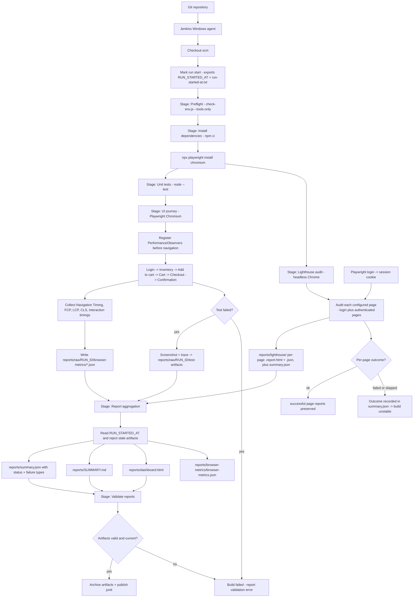

# Architecture

## Purpose

`ui-performance-poc` demonstrates browser-level UI performance testing that **complements** JMeter.
JMeter exercises protocols and backend capacity; this project exercises a **real browser** for a
**single user** and measures what the user actually experiences.

## Component overview

| Component | File | Responsibility |
| --- | --- | --- |
| Config | [src/config.js](../src/config.js) | Environment-driven configuration; safe defaults; run-id resolution |
| Logger | [src/logger.js](../src/logger.js) | Dependency-free levelled logging; optional file append |
| Browser metrics | [src/browser-metrics.js](../src/browser-metrics.js) | Injects PerformanceObservers; per-page Navigation/Paint/LCP/CLS snapshots + interaction timings |
| Journey test | [tests/sauce-demo-journey.spec.js](../tests/sauce-demo-journey.spec.js) | The Playwright UI journey with assertions and per-checkpoint metric capture |
| Lighthouse audit | [src/lighthouse-audit.js](../src/lighthouse-audit.js) | Independent headless-Chrome lab audit of every configured page; per-page `ok`/`failed`/`skipped` outcomes |
| Quality gate | [src/quality-gate.js](../src/quality-gate.js) | Pure threshold + overall-status rules shared by the spec and report summary |
| Baseline | [src/baseline.js](../src/baseline.js) | Baseline compatibility check and regression classification (pure) |
| Dashboard | [src/html-report.js](../src/html-report.js) | Renders the consolidated `dashboard.html` (pure, self-contained) |
| Report summary | [src/report-summary.js](../src/report-summary.js) | Merges artifacts into `summary.json`, `SUMMARY.md`, `dashboard.html`; staleness guards |
| Validation | [scripts/validate-reports.js](../scripts/validate-reports.js) | Verifies artifacts exist, parse, and that the summary structure is well-formed |
| Preflight | [scripts/check-env.js](../scripts/check-env.js) | Fail-fast Node/npm/config validation before any run |
| Orchestration | [scripts/run-all.ps1](../scripts/run-all.ps1) | Runs all stages in order with a shared run id and run-start marker |

## Execution flow (Mermaid)

## Data flow and artifact lifecycle

1. A **run id** (`RUN_ID`, or a timestamp) is resolved once and exported via the environment so the
   Playwright config, the journey spec and the reporting scripts all agree.
2. The journey writes **raw** artifacts under `reports/raw/<runId>/` (browser metrics JSON, traces,
   screenshots) — previous runs are never overwritten.
3. Lighthouse writes its own reports plus a `summary.json` under `reports/lighthouse/`.
4. `report-summary.js` reads the Playwright JSON report, the raw browser metrics, the Lighthouse
   summary and the run-start marker (`reports/run-started-at.txt`). Artifacts whose timestamp or
   `runId` predates the current run are flagged as **stale** and excluded from the status decision.
   It then produces the **latest** convenient locations (`reports/summary.json`,
   `reports/SUMMARY.md`, `reports/dashboard.html`, `reports/browser-metrics/browser-metrics.json`).
5. `validate-reports.js` asserts the artifacts exist, are non-empty and parse, that
   `summary.json` uses the agreed status vocabulary and reports every configured Lighthouse page —
   and fails the build if a required artifact is missing or malformed.

## Status and failure classification

The overall status (`summary.status`) is one of `passed`, `failed`, `unstable` or `no-data`, decided
by the pure rules in [src/quality-gate.js](../src/quality-gate.js). The failures that contributed are
listed in `summary.failureTypes`:

| Type | Meaning | Status | Effect |
| --- | --- | --- | --- |
| `functional-test-failure` | A journey assertion failed | `failed` | Exit code 1; build fails |
| `performance-threshold-failure` | An **enabled** threshold was exceeded | `failed` | Exit code 1; build fails |
| `lighthouse-audit-failure` | A configured page audit could not run | `unstable` | Build marked unstable, reported separately |
| `lighthouse-partial-audit` | Some pages audited, others skipped | `unstable` | Build marked unstable — never reported as a pass |
| `missing-data` | Required metrics or Lighthouse evidence is absent | `unstable` / `no-data` | Downgraded, never a silent pass; `failed` when an enforced threshold is missing and `THRESHOLDS_STRICT=true` |

Rules that keep the status honest:

- A disabled threshold is **observation-only** and can never fail a build.
- Enabled-but-unconfigured thresholds produce a warning, not an implicit failure.
- An enforced threshold whose metric is unavailable cannot pass: the run is downgraded to `unstable`,
  or failed outright in strict mode (`THRESHOLDS_STRICT=true`).
- Missing evidence (`missing-data`) can never be presented as a pass.
- A passing Playwright test cannot mask a threshold breach — the gate evaluates functional and
  threshold outcomes independently.
- A stale artifact from a previous run cannot influence the current summary.

## Why browser testing complements (not replaces) JMeter

- **JMeter** scales protocol-level load across many virtual users and measures backend throughput /
  latency / error rates under concurrency.
- **This PoC** drives one real Chromium session and measures rendering, layout and interaction
  experience. It validates *what a user feels*, not *how the backend behaves at scale*.

See [limitations-and-next-steps.md](limitations-and-next-steps.md) for adaptation guidance.
