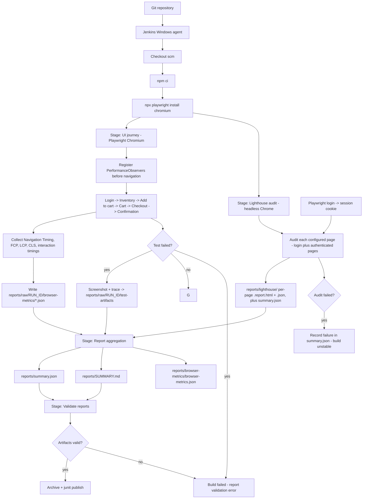

# Architecture

## Purpose

`ui-performance-poc` demonstrates browser-level UI performance testing that **complements** JMeter.
JMeter exercises protocols and backend capacity; this project exercises a **real browser** for a
**single user** and measures what the user actually experiences.

## Component overview

| Component | File | Responsibility |
| --- | --- | --- |
| Config | [src/config.js](../src/config.js) | Environment-driven configuration; safe defaults; run-id resolution |
| Logger | [src/logger.js](../src/logger.js) | Dependency-free levelled logging; optional file append |
| Browser metrics | [src/browser-metrics.js](../src/browser-metrics.js) | Injects PerformanceObservers, collects Navigation/Paint/LCP/CLS + interaction timings |
| Journey test | [tests/sauce-demo-journey.spec.js](../tests/sauce-demo-journey.spec.js) | The Playwright UI journey with assertions and metric capture |
| Lighthouse audit | [src/lighthouse-audit.js](../src/lighthouse-audit.js) | Independent headless-Chrome lab audit of every configured page (multi-page) |
| Report summary | [src/report-summary.js](../src/report-summary.js) | Merges all artifacts into `summary.json` + `SUMMARY.md`; threshold/baseline logic |
| Validation | [scripts/validate-reports.js](../scripts/validate-reports.js) | Verifies artifacts exist, are non-empty, and parse |
| Orchestration | [scripts/run-all.ps1](../scripts/run-all.ps1) | Runs all stages in order with a shared run id |

## Execution flow (Mermaid)

## Data flow and artifact lifecycle

1. A **run id** (`RUN_ID`, or a timestamp) is resolved once and exported via the environment so the
   Playwright config, the journey spec and the reporting scripts all agree.
2. The journey writes **raw** artifacts under `reports/raw/<runId>/` (browser metrics JSON, traces,
   screenshots) — previous runs are never overwritten.
3. Lighthouse writes its own reports plus a `summary.json` under `reports/lighthouse/`.
4. `report-summary.js` reads the Playwright JSON report, the raw browser metrics and the Lighthouse
   summary, then produces the **latest** convenient locations (`reports/summary.json`,
   `reports/SUMMARY.md`, `reports/browser-metrics/browser-metrics.json`).
5. `validate-reports.js` asserts the artifacts exist, are non-empty and parse — and fails the build
   if a required artifact is missing or malformed.

## Failure classification

The summary deliberately distinguishes three failure types:

| Type | Meaning | Effect |
| --- | --- | --- |
| Functional test failure | A journey assertion failed | `summary.status = failed`, exit code 1 |
| Performance threshold failure | An **enabled** threshold was exceeded | `summary.status = failed`, exit code 1 |
| Infrastructure / tool failure | Lighthouse (or setup) could not run | `summary.status = unstable`, reported separately |

This prevents a tooling problem from being silently presented as a functional pass, and prevents a
disabled threshold from ever failing a build.

## Why browser testing complements (not replaces) JMeter

- **JMeter** scales protocol-level load across many virtual users and measures backend throughput /
  latency / error rates under concurrency.
- **This PoC** drives one real Chromium session and measures rendering, layout and interaction
  experience. It validates *what a user feels*, not *how the backend behaves at scale*.

See [limitations-and-next-steps.md](limitations-and-next-steps.md) for adaptation guidance.
